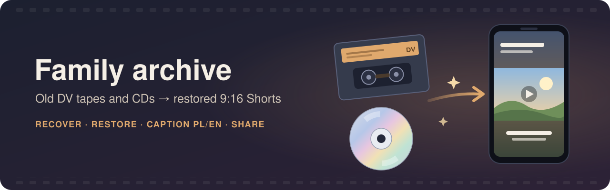

# Family archive

Tools and Claude Code skills for restoring family DV tapes and old CDs, and publishing them.

- **Local setup:** copy `local.env.example` to `local.env` (not in git) and fill in the archive folder,
  the tape capture folders and the YouTube channel id. The skills read their paths from it.
- **Sources:** DV tape captures in the archive folder (`$SOURCES_PAL`, `$SOURCES_NTSC`); CDs and DVDs in
  drive `D:`.
- **Recovered discs:** `$ARCHIVE/CD_<label>_<year>/`.
- **Working files:** `work/<tape>/` in this repo (not in git).
- **Finished videos:** `$SHORTS/<tape>_<date>/`.

## Skills

Skills live in `.claude/skills/<name>/`. Claude Code loads them automatically when it is started in
this folder. You can call a skill by name (`/family-shorts`), or describe the job in plain words and
Claude picks the matching skill.

| Skill | What it does | Say something like |
|---|---|---|
| [`family-shorts`](.claude/skills/family-shorts/SKILL.md) | One DV tape → restored 9:16 YouTube Shorts with Polish/English captions, rendered with HyperFrames and uploaded to the family YouTube channel | "make shorts from tape 002", "upload shorts 09–11", "make short 05 unlisted" |
| [`cd-recovery`](.claude/skills/cd-recovery/SKILL.md) | An old CD or DVD → its videos and photos copied off, damaged spots skipped instead of freezing the drive, videos converted to MP4 with a contact sheet and a damage report | "explore the CD in the drive", "rescue the videos on this CD", "the copy from D: is stuck" |

### family-shorts

**What it makes.** Each tape becomes several 45–90 s vertical shorts:

- **Picture:** blur-fill framing (the full 4:3 picture over a blurred copy of itself), restored by
  deinterlacing, stabilising, denoising and upscaling.
- **Sound:** the original camcorder audio, cleaned and normalised. No music.
- **Text:** a Polish title with an English subtitle, at most two short captions, and an end card.
  No people or places are named.
- **No repeats:** no scene appears in two shorts.

**How a session goes.**

1. **Ask:** start Claude Code in this folder and say e.g. *"make shorts from tape 002"*.
2. **Scan:** Claude scans the tape (about 20 min) and reads contact sheets of the whole tape.
3. **Storyboard:** Claude proposes a storyboard: the shorts, their shots with timecodes, and the
   captions. Adjust anything here; this is the cheap moment to change your mind.
4. **Make:** Claude enhances the shots, builds and checks the HyperFrames projects, and renders them.
   The MP4s and a `manifest.json` appear in the tape's Shorts folder.
5. **Review:** watch them there.
6. **Upload:** say *"upload shorts 09–11"* (unlisted unless you name private or public). Nothing is uploaded
   without this. You get the links back.

**Limits worth knowing.**

- **Uploads:** YouTube allows **100 uploads per day** on this project (videos.insert has its own quota bucket).
- **YouTube sign-in:** it expires after about **7 days**, because the Google app is in testing mode.
  When it does (or before a long upload run), sign in again from the repo root; it opens a browser:

  ```bash
  uv run --no-project --with google-api-python-client --with google-auth-oauthlib python \
    .claude/skills/family-shorts/scripts/yt_family.py auth --from-token ~/.config/family-archive-youtube/token.json
  ```

  In Claude Code, prefix it with `!` so it runs in the session.
- **Pace:** enhancement and rendering are CPU-heavy and memory-limited in WSL. Expect 1–2 hours of
  machine time per tape, and avoid heavy work in VS Code meanwhile.

**Which copy of a tape is used.** For tapes 001–003 the "PAL" folder holds the better copy of the same
NTSC recording; the "NTSC" copies of 001–003 are redundant. For tapes 005–008 the two folders are
separate captures (PAL is sharper; NTSC has smoother motion), so keep both. Details are in
`work/compare/<tape>/summary.txt`.

**Scripts** (in `.claude/skills/family-shorts/scripts/`; each takes the tape folder `work/<tape>`
first and reads its `plan/tape.json`):

| Script | Job |
|---|---|
| `scan.sh` | Contact sheets, scene cuts and loudness for a whole tape |
| `verify_sheet.sh` | Start/middle/end stills of every shot of one short |
| `enhance.sh` / `enhance_batch.sh` | Restore shots to 1080x1920 clips (NTSC or PAL), 3 at a time |
| `make_short.py` | Build a HyperFrames project from `plan/shortNN.tsv` + `plan/copy.json` |
| `render_all.sh` | Render one by one and copy to the Shorts folder |
| `manifest.py` | Add rendered shorts to the folder's `manifest.json` |
| `upload.sh` / `yt_family.py` | Upload to YouTube, change privacy |
| `compare_pair.sh` | Compare a tape's "PAL" and "NTSC" copies |

`tools/yt_family.py` and `tools/compare_pair.sh` are links to the skill's copies. `work/001/scripts/`
holds the original tape-001 versions and is kept for reference only.

**Status.** Uploads are unlisted by default. Each tape's `manifest.json` in `$SHORTS/<tape>_<date>/`
records what was uploaded, with links.

### cd-recovery

**Why it exists.** CDs burned around 2000 fade and scratch. A normal Windows copy (Explorer, `Copy-Item`)
retries a bad spot for minutes and can freeze the drive. The copy process then can't be killed, and only
unplugging the drive or restarting Windows frees it. This skill copies around the damage instead.

**What it makes.** In `$ARCHIVE/CD_<label>_<year>/`:

- **Raw copies:** the disc's video and photo files, with any unreadable spots blanked. These are the best
  copy that exists; keep them.
- **`<name>_recovered.mp4`:** each video converted so any player opens it (a Video CD track, a DVD title
  with its parts joined, or a video file).
- **`<name>_sheet.jpg`:** 42 frames spread across the video, to see the content and the damage at a glance.
- **`<name>_damage.txt`:** decoder errors per minute. 0 means a clean minute, hundreds a mostly broken
  picture. Use it to find the parts worth using.
- **`damaged.txt`:** photos that won't open, if any.
- **Logs:** `recover.log` (one line per file) and `<file>.log` (every bad spot and jump).

**How a session goes.**

1. **Ask:** put the disc in, start Claude Code in this folder and say e.g. *"explore the CD in the
   drive"*.
2. **Inventory:** Claude lists what is on the disc (type, files, sizes, dates), reading only the file
   list.
3. **Recover:** Claude copies the media files in the background. A healthy disc takes minutes; a damaged
   one can take hours. Leave the disc in, and don't open it in Explorer, IsoBuster or a player
   meanwhile, since two readers slow the drive and can freeze it.
4. **Review:** Claude converts the videos and reads the contact sheets, then tells you what is on the disc
   and how good it is.
5. **Shorts (optional):** if the quality is good enough, ask for shorts and the `family-shorts` skill
   takes the recovered MP4.

**If the drive freezes.** You'll know because the copy stops growing and even listing the disc times
out. Unplug the USB drive for 10 seconds and plug it back in; ejecting the disc is not enough. If it is
still stuck, restart Windows. Then ask Claude to continue. The copy resumes where it stopped, and
finished files are not read again.

**What to expect from a damaged disc.** The bad-spot count understates the damage. Video CDs store video
without error correction, so most damage reads back as garbled picture rather than as an error. The
contact sheet and the damage table show the real quality. When the copy keeps hitting bad spots, it
jumps ahead (about 1 s of video, doubling up to about 16 s). That way a badly damaged disc finishes in
hours, at the cost of a few seconds of video around each damaged stretch. To keep more on a short,
precious disc, ask for a smaller jump. Other things that can help a bad disc: a different (older) CD
drive, a disc resurfacing service for scratches, or the original camcorder tape if it still exists.

**Scripts** (in `.claude/skills/cd-recovery/scripts/`):

| Script | Job |
|---|---|
| `inventory.sh [D]` | Drive, label, file list, disc type and recent read errors; reads only the directory |
| `recover.sh D <dest>` | Copies the media files one at a time with `salvage.ps1`; resumes; `--all` copies every file, `JUMP=15` keeps more video |
| `salvage.ps1` | Copies one file in Windows, blanking unreadable sectors and jumping over bad runs |
| `review.sh <dest>` | MP4s, contact sheets and per-minute damage tables; checks photos |

## Adding a skill

Create `.claude/skills/<name>/SKILL.md` with `name` and `description` front matter. The description
says when Claude should use the skill. Put helper scripts in `scripts/` next to it, and add a row to
the table above plus a short section on how to use it.
